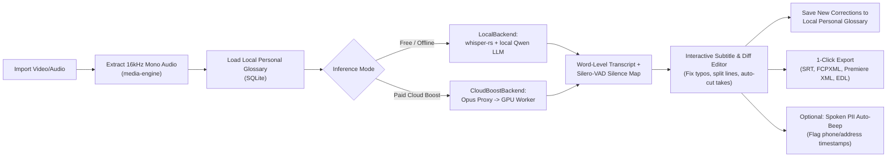
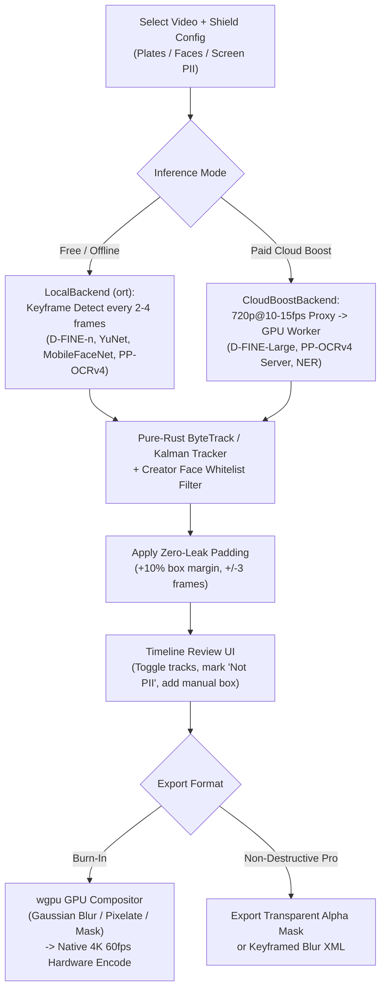
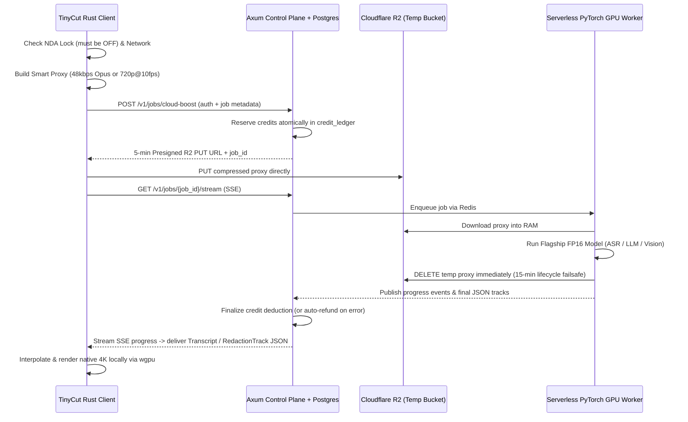
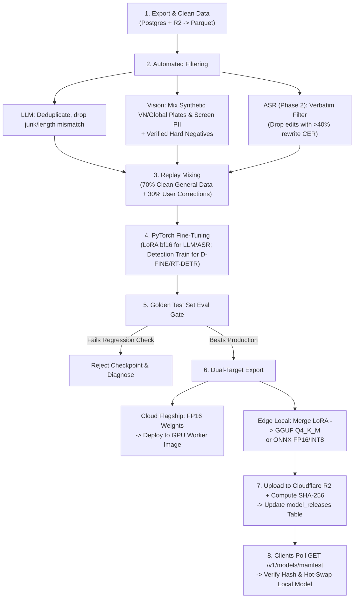

# TinyCut — System, ML & Engineering Workflows

This document defines the end-to-end runtime, data-flywheel, ML training, and engineering workflows for **TinyCut**, aligned with [BASELINE.md](./BASELINE.md).

---

## 1. Creator Runtime Workflows (In-App)

### 1.1 Smart Subtitles, Personal Glossary & Auto-Cut

### 1.2 Visual Privacy Shield (Plates, Faces, Screen PII)

---

## 2. Hybrid Cloud Boost Workflow (Smart Proxy Offloading)

Raw 4K source files stay on the user's device. Only lightweight proxies travel to ephemeral cloud storage, and only JSON results return.

### Failure & Offline Fallback Rules
1. If network is unavailable or `project.is_nda_private == true`, route automatically to `LocalBackend`.
2. If the GPU worker times out or crashes, the Axum control plane automatically refunds reserved minutes in `credit_ledger` and offers local fallback.

---

## 3. Opt-In Data Flywheel & Privacy Gate Workflow

Strict separation from Cloud Boost. Only executes if the user has explicitly opted in AND the current project is **not** NDA-locked.

### 3.1 Text-Diff Telemetry (Level 1 Opt-In)
1. **Trigger:** User finishes editing subtitles and clicks Export.
2. **Gate Check:** Verify `settings.opt_in_text_diffs == true && !project.is_nda_private`.
3. **Diff Extraction:** Compute word-level diff between `(raw_asr, llm_draft)` and `user_final`. Drop unchanged segments.
4. **On-Device PII Scrubber:** Regex-redact emails, phone numbers, URLs, bank/ID numbers, and API keys locally before queuing.
5. **Offline Queue & Batch Upload:** Store in local SQLite queue; upload batches on Wi-Fi via `POST /v1/telemetry/text-diffs` with a rotatable `anonymous_client_id`.

### 3.2 Vision Hard-Negative Telemetry (False Positives Only)
1. **Trigger:** User clicks **"Not PII / Unblur"** on a false-positive detection (e.g., street sign, speedometer, poster).
2. **Gate Check:** Verify `settings.opt_in_vision_negatives == true && !project.is_nda_private`.
3. **Client Crop:** Extract **only** the rejected bounding box (clamped to `<= 256×256px`). Never send user-drawn "missed PII" boxes.
4. **Server Safety Gate:** Before storing in `tinycut-flywheel` R2 bucket, an automated server-side face detector + OCR/PII scanner inspects the crop; if *any* face or sensitive text is detected, the image is **immediately discarded**.

### 3.3 User Data Deletion Compliance
- User clicks **"Delete My Contributed Data"** → client sends `DELETE /v1/telemetry/me` with `anonymous_client_id` → Axum deletes all matching Postgres rows and R2 objects, then rotates the local anonymous ID.

---

## 4. PyTorch ML Training & OTA Model Release Workflow

Run periodically (e.g., monthly or per data milestone) on rented GPU compute (RunPod / Lambda / Vast.ai).

---

## 5. Engineering & Milestone Execution Workflow

### 5.1 Repository & Branching Discipline
- **Monorepo:** Single repository containing `crates/`, `apps/ui-shell/`, `server/`, and `ml/`.
- **Shared Types First:** Any change to transcripts, diffs, redaction tracks, or API payloads starts in `crates/core-domain/` so client and server never drift out of sync.
- **Pre-Merge Checks (CI):**
  - Rust: `cargo fmt --check`, `cargo clippy --workspace --all-targets -- -D warnings`, `cargo test --workspace`.
  - ML (`ml/`): `ruff check`, unit tests for data filters/PII scrubbers, and ONNX export shape verification.

### 5.2 Step-by-Step Milestone Execution Order

1. **Phase 0 — Workspace Bootstrap**
   - [x] Initialize Cargo workspace (`core-domain`, `media-engine`, `ai-audio`, `vision-shield`, `gpu-compositor`, `export-engine`, `local-store`, `sync-client`, `server`).
   - [x] Define `InferenceBackend` trait and WASM-clean core structs (`Transcript`, `RedactionTrack`, `EditDiff`, `ModelManifest`).
   - [x] Lock in and scaffold **Tauri v2 + Dioxus (WASM)** (`apps/ui-dioxus` + `apps/ui-shell/src-tauri`).
2. **Phase 1 — v0.1 Desktop MVP (macOS & Windows)**
   - [ ] Wire local audio pipeline: audio extraction → `whisper-rs` → SQLite Personal Glossary → SRT/FCPXML exporter.
   - [ ] Wire local vision pipeline: `ort` (`YuNet` + `MobileFaceNet` whitelist + baseline plate detector) → `ByteTrack` + Zero-Leak padding → `wgpu` blur shader.
   - [ ] Build interactive subtitle/diff editor and timeline track toggle UI.
3. **Phase 2 — v0.2 Server, Cloud Boost & First Flywheel**
   - [ ] Stand up `server/` (`Axum` + PostgreSQL + Redis + Cloudflare R2).
   - [ ] Implement `CloudBoostBackend` (Smart Proxy Offloading + SSE progress + atomic credit ledger + immediate R2 cleanup).
   - [ ] Deploy initial Modal/RunPod Serverless GPU worker.
   - [ ] Enable opt-in Text-Diff & Vision Hard-Negative telemetry + `DELETE /v1/telemetry/me`.
   - [ ] Run first PyTorch training cycles: synthetic VN/SEA plate detector (ONNX) + Qwen bilingual subtitle fixer (GGUF) and ship via `/v1/models/manifest`.
4. **Phase 3 — v0.3 Mobile Expansion (iOS, iPadOS, Android)**
   - [ ] Implement sequential model loading/unloading for strict mobile RAM budgets (<2.5GB).
   - [ ] Integrate native media pipelines (AVFoundation on Apple, MediaExtractor/MediaCodec on Android).
   - [ ] Add Apple IAP & Google Play Billing to the credit ledger.
5. **Phase 4 — v0.4 Pro Integrations & Audio Flywheel**
   - [ ] Add Screen-Recording PII detector (`PP-OCRv4` + NER/Regex) and Spoken PII Auto-Beep.
   - [ ] Add non-destructive transparent alpha-mask / keyframed XML export for FCP, Premiere, and DaVinci Resolve.
   - [ ] Launch incentivized Level-2 clipped audio opt-in and Whisper LoRA fine-tuning pipeline.
