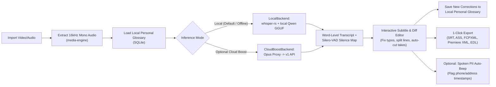
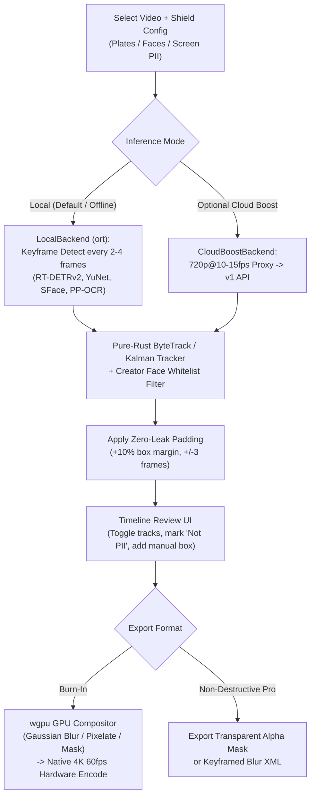
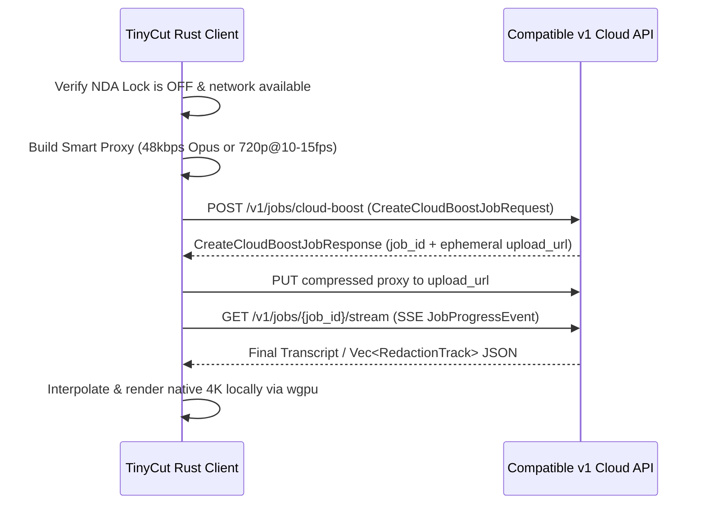

# TinyCut — Client Runtime & Engineering Workflows

This document defines the client-side runtime, privacy-gate, and engineering workflows for the open-source **TinyCut** application, aligned with [BASELINE.md](./BASELINE.md).

> Server-side data storage, Cloud Boost GPU workers, and PyTorch model training workflows live in the separate private cloud/ML repository (`tinycut-cloud`).

---

## 1. Creator Runtime Workflows (In-App)

### 1.1 Smart Subtitles, Personal Glossary & Auto-Cut


### 1.2 Visual Privacy Shield (Plates, Faces, Screen PII)


---

## 2. Client-Side Smart Proxy Offloading (`v1` Protocol)

Raw 4K source files never leave the user's device. When Cloud Boost is enabled and the project is not NDA-locked:



### Failure & Offline Fallback Rules
1. If network is unavailable, `TINYCUT_API_BASE_URL` is unset, or `project.is_nda_private == true`, route automatically to `LocalBackend`.
2. If a remote job errors or times out, surface the error cleanly and offer immediate local fallback.

---

## 3. Client-Side Opt-In Privacy Gate

Only executes when compiled with the `telemetry` feature, explicitly opted in by the user, AND `!project.is_nda_private`:

1. **Gate Check:** `can_send_telemetry(user_opted_in, &project)` checks both opt-in consent and the NDA lock.
2. **On-Device PII Scrubber:** `scrub_pii` redacts emails, URLs, API key prefixes (`sk-...`), and numeric sequences (`>= 9` digits) locally before queuing into SQLite.
3. **Hard-Negative Crops Only:** Vision feedback only ever sends user-confirmed false-positive crops clamped to `<= 256×256px` — never real faces, real plates, or missed-PII boxes.
4. **Right to Erasure:** User can invoke `DELETE /v1/telemetry/me` with their rotatable `anonymous_client_id` and immediately rotate the local ID.

---

## 4. Engineering & CI Workflow

### Repository & Protocol Discipline
- **Client Repo (`tinycut`):** Contains `crates/` and `apps/` only. No server secrets, billing logic, database migrations, or training scripts.
- **Shared Contract First:** Any change to wire payloads lives in `crates/core-domain/src/protocol.rs` (versioned under `PROTOCOL_VERSION = "v1"`). Backend repos consume `tinycut-core-domain` via pinned git tags/commits (and local Cargo `[patch]` overrides during co-development).
- **Pre-Merge Checks (CI):**
  ```bash
  cargo fmt --check
  cargo clippy --workspace --all-targets -- -D warnings
  cargo test --workspace
  cargo check -p tinycut-core-domain --no-default-features
  cargo check -p tinycut-sync-client --no-default-features
  ```

### Client Milestone Tracker
1. **Phase 0 — Workspace Bootstrap**
   - [x] Initialize Cargo workspace (`core-domain`, `model-hub`, `media-engine`, `ai-audio`, `vision-shield`, `gpu-compositor`, `export-engine`, `local-store`, `sync-client`).
   - [x] Define `InferenceBackend` trait, WASM-clean domain structs, and `v1` wire protocol (`core-domain/src/protocol.rs`).
   - [x] Scaffold **Tauri v2 + Dioxus (WASM)** (`apps/ui-dioxus` + `apps/ui-shell/src-tauri`).
2. **Phase 1 — v0.1 Desktop MVP (macOS, Windows, Linux)**
   - [x] Wire local audio pipeline: audio extraction → `whisper-rs` → `candle` Qwen fixer → SQLite Personal Glossary → SRT/ASS/FCPXML/Premiere/EDL exporter.
   - [x] Wire local vision pipeline: `ort` (`YuNet` + `SFace` whitelist + `RT-DETRv2` plate detector) → `ByteTrack` + Zero-Leak padding → `wgpu` blur shader.
   - [x] Build interactive subtitle/diff editor, model manager, and timeline track toggle UI.
   - [x] Separate private server / cloud inference / ML pipelines into a dedicated repository.
3. **Phase 2 — v0.2 Cloud Boost Client & OTA Manifests**
   - [ ] Implement HTTP/SSE transport in `CloudBoostBackend` against the `v1` protocol.
   - [ ] Add signed OTA manifest polling in `crates/model-hub`.
4. **Phase 3 — v0.3 Mobile Expansion (iOS, iPadOS, Android)**
   - [ ] Implement sequential model loading/unloading for strict mobile RAM budgets (<2.5GB).
   - [ ] Integrate native media pipelines (AVFoundation on Apple, MediaExtractor/MediaCodec on Android).
5. **Phase 4 — v0.4 Pro Integrations**
   - [ ] Wire Screen-Recording PII detector (`PP-OCRv4` + NER/Regex) and Spoken PII Auto-Beep in UI.
   - [ ] Add non-destructive transparent alpha-mask / keyframed XML export for FCP, Premiere, and DaVinci Resolve.
